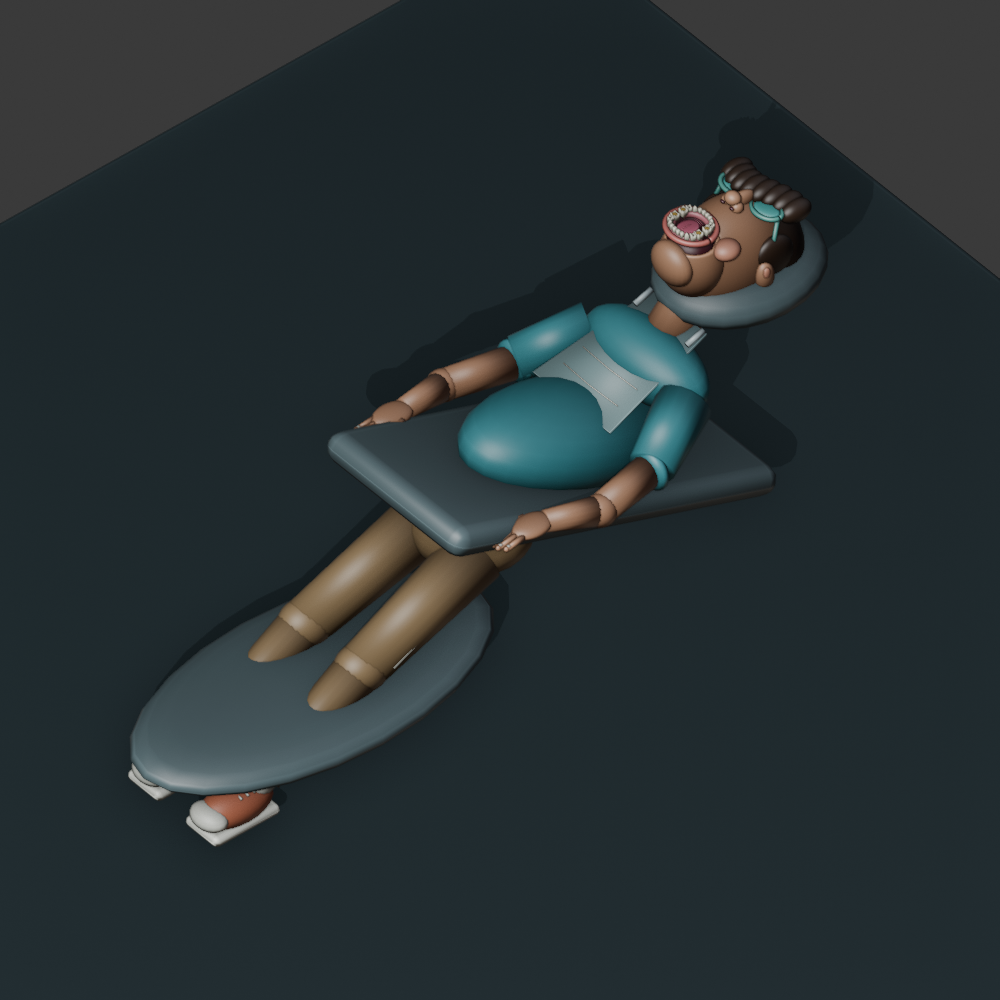

# Little Smiles

[](https://github.com/aranlucas/cavity-game/actions/workflows/ci.yml)
Little Smiles is a gentle single-player dental-care game. Explore a 3D clinic and care for three fictional patients: inspect → clean → repair → fill → cure. Keep them comfortable and earn their smile-club stickers. The anatomy and treatment sequence are simplified fiction, not clinical training.



_This is an asset preview from the project's Blender models, not a gameplay screenshot._

## Run

Use the Node.js version in [`.node-version`](.node-version) and the pnpm version in [`package.json`](package.json).

```bash
pnpm install
pnpm run dev
```

Open **https://cavity-game.localhost**. Development uses [Portless](https://github.com/vercel-labs/portless); its first run may ask for `sudo` to bind port 443 and trust a local certificate. No backend or account is needed. Progress and sound settings save in this browser's local storage; returning starts in the room with the current visit ready to resume. The menu reports storage failures.

## Play

- **WASD / arrow keys** move around the clinic. Drag to look around. On touch screens, use the movement pad and drag the scene.
- Approach the patient chair and press **E** or choose **Begin treatment**. The camera moves into a close-up of the patient's mouth in the same room.
- Select instruments with **1–5** or the compact tool belt. Aim and hold on a marked tooth; numbered targets also support Tab and Space/Enter.
- Repair in short bursts. Release to cool the bur; reassure the patient to restore comfort.
- **Q / Room** returns to the clinic. **Escape / Menu** pauses, opens controls, and offers sound, fullscreen, restart-visit, and new-day controls. Switching away from the page pauses automatically.
- Finish all five stages for each patient to complete a clinic day. Start a new day to play again; collected stickers stay in your album.

## Development

See [asset provenance and rebuilding](assets/ATTRIBUTION.md), [font provenance](client/public/fonts/README.md), and the [feature roadmap](ROADMAP.md).

```bash
pnpm test
pnpm run build
pnpm run lint
pnpm run format:check
```

`pnpm run build` typechecks the client and runs the Cloudflare build and deployment dry run (`cf deploy --dry-run`); it uploads nothing. `pnpm test` includes a tooling typecheck before Vitest. [CI](.github/workflows/ci.yml) runs these checks, lint, and formatting.

To publish, authenticate with `pnpm --filter @cavity-rush/client exec cf auth login` (or set `CLOUDFLARE_API_TOKEN` and `CLOUDFLARE_ACCOUNT_ID` in CI), then run `pnpm run deploy`. This typechecks, builds, and publishes static assets with a single-page application fallback. [Cloudflare config](client/cloudflare.config.ts) retains the `GameRoom` deletion declaration to retire the former multiplayer namespace; preserve it when changing deployment configuration.
